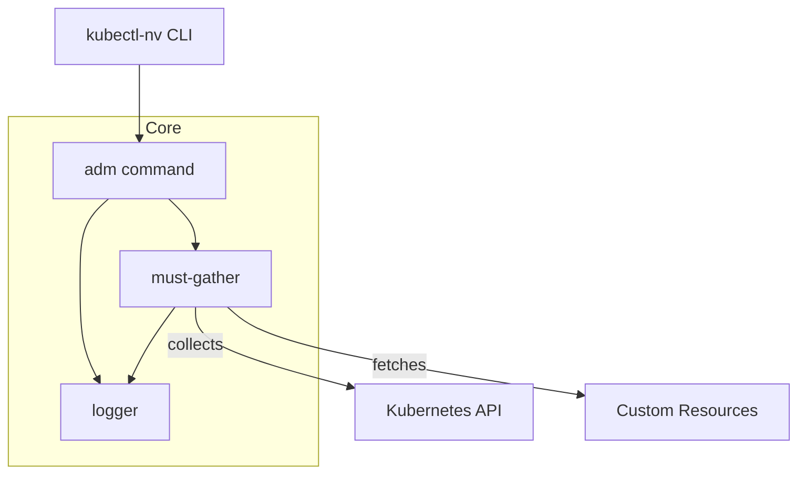

# kubectl-nv Documentation

## Overview

`kubectl-nv` is a kubectl plugin for troubleshooting NVIDIA GPU
resources in Kubernetes clusters. It never changes Kubernetes objects.
Today it provides one command, `kubectl nv adm must-gather`, which
collects a diagnostic bundle from a cluster where the NVIDIA GPU
Operator is deployed. Gathering it runs `nvidia-bug-report.sh` inside
the driver pods, which needs permission to create `pods/exec`.

## Quick Start

Install a released binary from the
[GitHub release page](https://github.com/NVIDIA/kubectl-nv/releases), or build
from source:

```bash
git clone https://github.com/NVIDIA/kubectl-nv.git
cd kubectl-nv
make build
./bin/kubectl-nv --help
```

Either way, see [Installation](installation.md) for verifying the download and
putting `kubectl-nv` on your `PATH` so that `kubectl nv` resolves.

## Architecture



## Documentation Index

- [Usage](usage.md)
- [Installation](installation.md)
- [Design](design.md)
- [Contributing](contributing.md)
- [Testing](testing.md)
